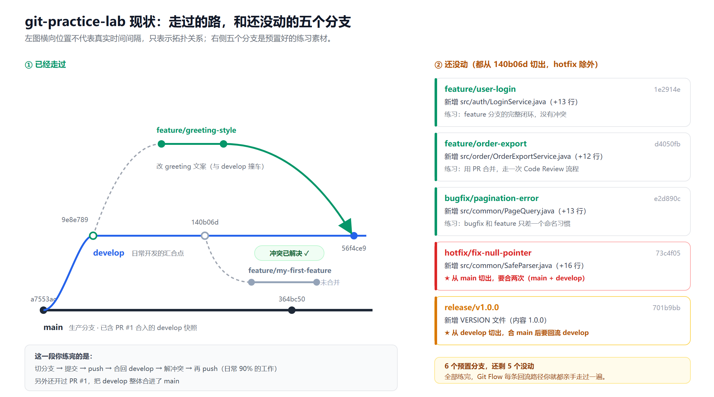

# git-practice-lab

Git 分支协作练习仓库（极简版），模拟真实后端团队的分支工作流。

仓库里没有真正的业务代码，只有几个 Java 骨架类和一堆**故意预置好**的分支场景：日常功能、普通 bug、线上紧急修复、发版准备，以及一次人为制造的合并冲突。目的是把分支规则练成本能，而不是背命令。

> 📘 **完整练习手册：[docs/Git协作练习手册.md](docs/Git协作练习手册.md)**
> 含四张手绘分支图、八个分步练习、命令速查表和报错对照表。

---

## 快速开始

```bash
git clone https://github.com/elthereal-star/git-practice-lab.git
cd git-practice-lab
git branch -a
git log --oneline --graph --all --decorate -15
```

先跑最后一条，看清楚这个仓库的分支长什么样，再打开手册从练习 2 开始。

---

## 分支模型（Git Flow 简化版）

| 分支 | 用途 | 从哪里切出 | 合并回哪里 |
| --- | --- | --- | --- |
| `main` | 生产分支，永远保持可发布状态 | - | - |
| `develop` | 开发集成分支，日常功能的汇合点 | `main` | `main`（通过 release） |
| `feature/*` | 新功能开发 | `develop` | `develop` |
| `bugfix/*` | 普通 bug 修复 | `develop` | `develop` |
| `release/*` | 发版准备（冻结功能，只修 bug） | `develop` | `main` + `develop` |
| `hotfix/*` | 线上紧急修复 | `main` | `main` + `develop` |

最后两行是重点：**`release` 和 `hotfix` 都要合并两次**。只合 `main` 不回 `develop`，下次发版会把线上的修复冲掉。

---

## 预置分支与进度



`main` 目前停在 `364bc50` —— 那是 PR #1 把 `develop` 整体合进来的那次合并。如果你本地 `main` 还显示 `a7553ac`（initial commit），说明从没拉过，练习 5、6 之前务必先 `git checkout main && git pull`。

| 分支 | 改动 | 练习 | 状态 |
| --- | --- | --- | --- |
| `feature/greeting-style` | 改 greeting 文案，与 develop 冲突 | 练习 4 | ✅ 已合并（含冲突解决） |
| `feature/order-export` | 新增 `src/order/OrderExportService.java` | 练习 2 | ⬜ 待练 |
| `bugfix/pagination-error` | 新增 `src/common/PageQuery.java` | 练习 3 | ⬜ 待练 |
| `hotfix/fix-null-pointer` | 新增 `src/common/SafeParser.java` | 练习 5 | ⬜ 待练 |
| `release/v1.0.0` | 新增 `VERSION` | 练习 6 | ⬜ 待练 |
| `feature/user-login` | 新增 `src/auth/LoginService.java` | 练习 2 备选 | ⬜ 待练 |

`feature/greeting-style` 的冲突已经在 `develop` 上解决过一次（合并提交 `56f4ce9`）。想重练冲突，先执行：

```bash
bash scripts/reset-to-conflict.sh
```

脚本会把本地 `develop` 退回冲突发生前的状态，并自动打一个 `backup/develop-before-reset` 标签，随时可还原。只影响本地，不会推送。

---

## 目录结构

```
.
├── README.md
├── docs/
│   ├── Git协作练习手册.md          完整练习手册
│   └── images/                     四张示意图（.svg 源文件 + .png 渲染产物）
├── scripts/
│   ├── reset-to-conflict.sh        练习 4 的重置脚本
│   └── render-images.sh            SVG → PNG 批量渲染
└── src/
    └── HelloBackend.java
```

---

## 建议练习顺序

1. clone 仓库，用 IDEA 打开
2. 基于 `develop` 新建自己的 `feature/xxx`，提交并推送 —— 练习 1
3. 用 PR 把 `feature/order-export` 合进 `develop` —— 练习 2
4. 本地合并 `bugfix/pagination-error` —— 练习 3
5. 重置后重练冲突解决 —— 练习 4
6. 把 `hotfix/fix-null-pointer` 合进 `main` **和** `develop` —— 练习 5（核心）
7. 把 `release/v1.0.0` 合进 `main`，打 tag，再回流 `develop` —— 练习 6
8. 进阶：`rebase` vs `merge`、撤销三件套 —— 练习 7、8
