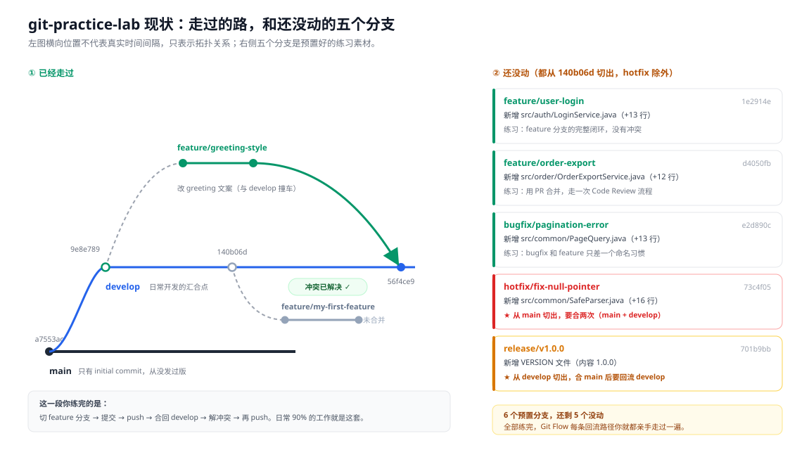
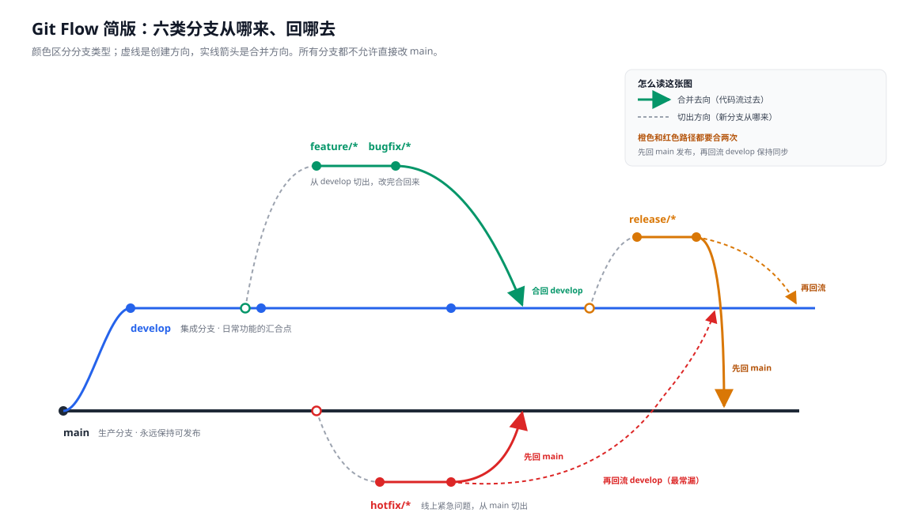
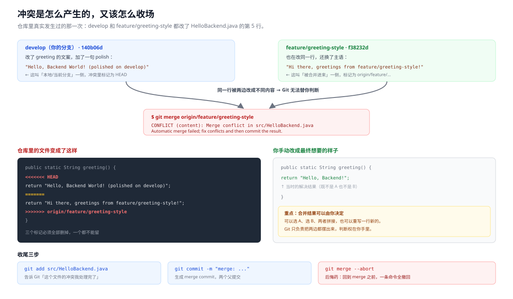
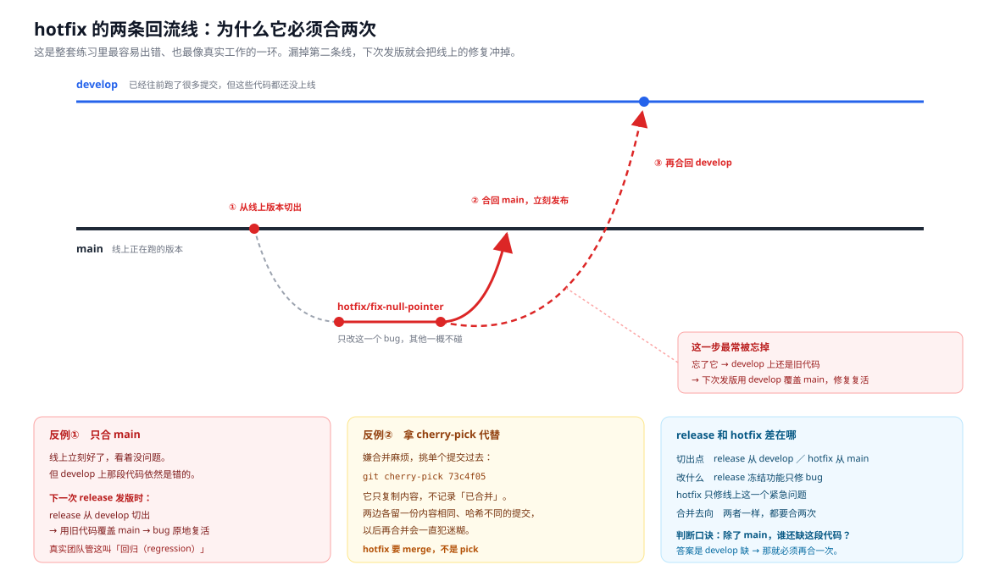

# Git 分支协作练习手册

> 配套仓库：`git-practice-lab`
> 本地路径：`D:\ai\git练习`　远端：https://github.com/elthereal-star/git-practice-lab
> 手册版本：2026-11-13　预计耗时：2～3 小时（可拆成三次）

这个仓库不是用来写代码的，是用来**把 Git 的分支规则练成本能**的。里面的每个分支都模拟了真实后端团队会遇到的场景：日常功能、普通 bug、线上紧急修复、发版准备，以及一次故意制造的冲突。

练完的标准不是"命令敲对了"，而是**能自己画出代码从哪个分支流到哪个分支**。面试被问"你们团队分支怎么管的"，你应该能当场画出来。

---

## 0. 一分钟准备

### 0.1 仓库在哪

| 项目 | 值 |
| --- | --- |
| 本地路径 | `D:\ai\git练习` |
| 远端地址 | `https://github.com/elthereal-star/git-practice-lab.git` |
| 默认分支 | `main` |
| 当前所在分支 | `develop` |
| 仓库内容 | `README.md`、`.gitignore`、`src/HelloBackend.java` |

### 0.2 三个检查命令

每次动手前先跑这三条，确认状态干净、和远端对齐：

```bash
cd "D:/ai/git练习"
git status
git branch -a
git log --oneline --graph --all --decorate -15
```

`git status` 输出里出现 `nothing to commit, working tree clean` 才能开始下一步。有未提交的改动就先处理掉，否则切分支会把改动带过去，越弄越乱。

### 0.3 用 IDEA 打开

`File → Open → 选 D:\ai\git练习`。右下角会显示当前分支，点击可以直接切分支，比敲命令直观。**但练习时建议先敲命令，再用 IDEA 核对结果** —— 面试不会考 IDEA 按钮在哪。

---

## 1. 先看懂这个仓库现在的样子



左边是你已经走过的路：从 `main` 切出 `develop`，在 `develop` 上提交了两次，然后 `feature/greeting-style` 改了同一行代码造成冲突，你把它解开合回了 `develop`（合并提交 `56f4ce9`）。另外还推了一个 `feature/my-first-feature` 上去，内容只是加了一行注释，**没合并**。

右边是六个预置分支里还没动的五个。注意它们的切出点：

| 分支 | 从哪切出 | 改了什么 | 归属练习 |
| --- | --- | --- | --- |
| `feature/user-login` | `develop` | 新增 `src/auth/LoginService.java` | 练习 2 |
| `feature/order-export` | `develop` | 新增 `src/order/OrderExportService.java` | 练习 2 |
| `bugfix/pagination-error` | `develop` | 新增 `src/common/PageQuery.java` | 练习 3 |
| `hotfix/fix-null-pointer` | **`main`** | 新增 `src/common/SafeParser.java` | 练习 5 |
| `release/v1.0.0` | `develop` | 新增 `VERSION` 文件 | 练习 6 |

只有 `hotfix` 是从 `main` 切的 —— 这一点是后面所有麻烦的来源。

---

## 2. 规则：六类分支从哪来、回哪去



看这张图只需要抓三个点：

**第一，`main` 是只读的。** 没有任何人往 `main` 直接提交代码，它只在两种时刻前进：release 合并进来、hotfix 合并进来。这样 `main` 上的每一个点都对应一次线上发布，出问题能精确回滚到某个版本。

**第二，`feature` 和 `bugfix` 是短命的。** 从 `develop` 切出，两三天内合回去，然后立刻删掉。活过一周的分支，合并冲突会指数级变多。

**第三，橙色的 `release` 和红色的 `hotfix` 都要合两次。** 这是全篇最重要的一句话：

> 先合 `main` 让线上生效，再合 `develop` 让开发线也拿到这段代码。

为什么必须两次？因为 `main` 和 `develop` 是两条独立的线。只合 `main` 的话，`develop` 上根本没有这个修复。下次从 `develop` 切 release 发版时，那份没有修复的旧代码会覆盖 `main`，线上 bug 原地复活。真实团队管这叫**回归事故**。

| 分支 | 切出点 | 合并回 | 存活时间 |
| --- | --- | --- | --- |
| `main` | — | — | 永久 |
| `develop` | `main` | `main`（通过 release） | 永久 |
| `feature/*` | `develop` | `develop` | 1～3 天 |
| `bugfix/*` | `develop` | `develop` | 几小时～1 天 |
| `release/*` | `develop` | `main` + `develop` | 1～3 天 |
| `hotfix/*` | `main` | `main` + `develop` | 几小时 |

---

## 3. 练习任务

八个练习按依赖顺序排，前四个是主干，后两个是重点，最后两个是进阶。每个练习都是「目标 → 命令 → 验收」，命令可以直接复制。

### 练习 1　feature 闭环（已完成，当复习看）

你之前做过，这里只回顾一遍完整的六步，后面所有练习都是它的变体：

```bash
git checkout develop
git pull
git checkout -b feature/xxx        # 1. 从最新的 develop 切出
# ... 写代码 ...
git add .
git commit -m "feat: xxx"          # 2. 提交
git push -u origin feature/xxx     # 3. 推送并建立跟踪
# 4. 在 GitHub 上开 PR，合并进 develop
git checkout develop
git pull                            # 5. 拉回合并结果
git branch -d feature/xxx           # 6. 删掉本地分支
```

要点在顺序：**切之前必须 `pull`**，否则你的分支是从旧代码长出来的，合并时平白多出一堆冲突。

---

### 练习 2　用 PR 合并一个 feature（无冲突）

**目标**：走一次完整的 Pull Request 流程，理解"代码评审"发生在哪一步。

```bash
cd "D:/ai/git练习"
git fetch origin
git checkout -b feature/order-export origin/feature/order-export
git log --oneline -1
```

看到 `d4050fb feat: add order export service skeleton` 就对了。这条命令做了两件事：在本地创建一个同名分支，并让它跟踪远端的同名分支。

接下来**不要**在本地 merge，去 GitHub 上开 PR：

1. 打开 https://github.com/elthereal-star/git-practice-lab
2. 顶部会跳出黄色提示条 `feature/order-export had recent pushes` → 点 **Compare & pull request**
3. base 选 `develop`，compare 选 `feature/order-export`
4. 标题写 `feat: 订单导出服务骨架`，描述里写一句这个 PR 干了什么
5. 点 **Create pull request** → **Merge pull request** → **Confirm merge**
6. 合并后 GitHub 会问要不要删分支，点 **Delete branch**

**验收**：

```bash
git checkout develop
git pull
ls src/order/          # 应该能看到 OrderExportService.java
git log --oneline -3   # 应该有一条 "Merge pull request #N"
```

**这里要体会的是**：`Merge pull request` 默认生成的是一个 **merge commit**（两个父提交），不是把提交重新排一遍。所以历史里能清楚看到"这个功能是通过哪个 PR、什么时候合进来的"。

> 如果 `git push` 卡住或报 `Failed to connect`，是你机器上的代理配置残留（`http.proxy` 指向了一个没启动的端口）。临时绕过：
> ```bash
> git -c http.proxy= -c https.proxy= push origin develop
> ```

---

### 练习 3　合并一个 bugfix（本地合并，不走 PR）

**目标**：对比"本地 merge"和"PR merge"的差别 —— 其实底层是同一个动作，PR 只是加了一层网页界面和评审。

```bash
git checkout -b bugfix/pagination-error origin/bugfix/pagination-error
git checkout develop
git merge --no-ff bugfix/pagination-error -m "merge: 修复分页偏移量 bug"
```

`--no-ff` 的意思是「**即使能快进也强制生成一个合并提交**」。不加的话，如果 `develop` 自切出后没动过，Git 会直接把指针挪过去（fast-forward），历史里就看不出这里合并过一个分支。

**验收**：

```bash
git log --oneline --graph -5      # 应该看到分叉再汇合的菱形
cat src/common/PageQuery.java     # 看到 toOffset 的实现
```

打开这个文件看一眼：

```java
public static int toOffset(int page, int size) {
    // fix: convert 1-based page number to 0-based offset
    return (page - 1) * size;
}
```

前端传的页码从 1 开始，老代码直接当成 0 基偏移用，导致第一页永远查不到数据。这种 bug 在真实项目里非常常见 —— **两套编号体系对接时，边界永远要单独验一遍**。

---

### 练习 4　解决冲突 ★

**目标**：亲手制造一次冲突，然后解开。

⚠️ 注意：**这个冲突你之前已经解决过一次了**（`develop` 上的 `56f4ce9` 就是那次的产物）。所以要先把这个练习"重开一局"。

#### 4.1 重置到冲突发生前

```bash
cd "D:/ai/git练习"
git status                          # 必须是 clean
git checkout develop
git reset --hard 140b06d            # 回到"greeting 已改、还没合并"的状态
git log --oneline -3
```

此时 `develop` 应该是 `140b06d refactor: polish greeting copy on develop` 打头，`56f4ce9` 不见了。

> 这一步只改本地。如果你想把远端也退回去，需要 `git push --force-with-lease origin develop`。**强烈建议先不推** —— 保留远端那份"已解决"的历史，万一本地搞砸了还能 `git reset --hard origin/develop` 救回来。

#### 4.2 制造并观察冲突

```bash
git merge origin/feature/greeting-style
```

你会看到：

```
Auto-merging src/HelloBackend.java
CONFLICT (content): Merge conflict in src/HelloBackend.java
Automatic merge failed; fix conflicts and then commit the result.
```

打开 `src/HelloBackend.java`，会看到三个标记：

```java
    public static String greeting() {
<<<<<<< HEAD
        return "Hello, Backend World! (polished on develop)";
=======
        return "Hi there, greetings from feature/greeting-style!";
>>>>>>> origin/feature/greeting-style
    }
```



读懂这三个标记是关键：

- `<<<<<<< HEAD` 到 `=======` 之间，是**你当前分支**（`develop`）的内容
- `=======` 到 `>>>>>>>` 之间，是**被合并进来的分支**（`feature/greeting-style`）的内容
- 它俩夹在同一行，Git 不知道该留哪个，就把两个都摆出来让你选

#### 4.3 手动解决

把三个标记**全部删掉**，改成你最终想要的样子。三种典型解法：

| 解法 | 什么时候用 |
| --- | --- |
| 留 A（HEAD 那侧） | 对方那版是废弃的试验代码 |
| 留 B（incoming 那侧） | 你的改动被对方的新方案取代了 |
| 两个都不要，重写一行 | 双方改的都不完整，需要合并语义 |

你上次的解法是第三种 —— 两边的文案都没留，改回了最朴素的 `"Hello, Backend!"`。这说明**合并结果可以由你决定，Git 只负责把选项摆出来**。

改完是这样：

```java
    public static String greeting() {
        return "Hello, Backend!";
    }
```

#### 4.4 提交合并

```bash
git add src/HelloBackend.java
git commit -m "merge: 解决 greeting 文案冲突，统一为简洁版"
git log --oneline --graph -4
```

`git add` 的作用是告诉 Git「这个文件的冲突我处理完了」。忘了这步直接 commit，会报 `Committing is not possible because you have unmerged files`。

**验收**：`git log --graph` 里出现一个合并提交，且两条父线都汇入它。

**后悔药**：如果解到一半发现搞错了，`git merge --abort` 一条命令回到 merge 之前，所有东西都会还原。多按几次不丢人。

---

### 练习 5　hotfix 双回流 ★★（本套练习的核心）

**目标**：搞懂为什么 hotfix 要合两次，以及漏掉第二次会发生什么。



#### 5.1 建本地分支

```bash
git fetch origin
git checkout -b hotfix/fix-null-pointer origin/hotfix/fix-null-pointer
cat src/common/SafeParser.java
```

内容是一个判空兜底：

```java
public static int parseIntSafely(String value, int fallback) {
    // hotfix: return fallback instead of throwing NPE on null
    if (value == null) {
        return fallback;
    }
    return Integer.parseInt(value);
}
```

模拟的是线上环境传了个 `null` 进来直接 NPE 崩溃，紧急加一行判断。

#### 5.2 第一次合并：进 main

```bash
git checkout main
git merge --no-ff hotfix/fix-null-pointer -m "merge: 线上 NPE 紧急修复进 main"
git push origin main
```

到这一步，线上问题解决了。

#### 5.3 第二次合并：回流 develop

```bash
git checkout develop
git merge origin/hotfix/fix-null-pointer -m "merge: 同步线上 NPE 修复到 develop"
git push origin develop
```

**注意这里用的是 `origin/hotfix/...` 而不是本地分支名。** 因为远端分支在 5.2 之后没有变化，两者指向同一个提交，效果一样。用远端引用更保险 —— 万一你本地那个分支后面又动了，不会把多余的东西带进来。

#### 5.4 验收

```bash
git checkout develop
git log --oneline --graph --all -12
ls src/common/SafeParser.java     # develop 上应该也有这个文件了
```

**关键对比实验**（强烈建议做一遍，印象比看文档深十倍）：

```bash
# 假设你只合了 main，没合 develop。可以用下面方式模拟后果：
git checkout develop
git log --oneline -1 -- src/common/SafeParser.java
# 如果这条查不到东西 → 说明 develop 上压根没有这个修复
```

真实事故链条是这样的：

1. 线上 NPE，hotfix 合进 `main`，线上恢复 ✓
2. 但 `develop` 上还是旧代码
3. 两周后从 `develop` 切 `release/v1.1.0` 发版
4. release 的代码里没有那个判空 → 覆盖 `main`
5. NPE 重现，这次还多了一个"明明修过"的疑问

#### 5.5 为什么不直接改 main

新手最容易问的一句：既然紧急，为什么不在 GitHub 网页上直接改 `main` 那一行？

因为 `main` 上的直接提交不会出现在 `develop` 里。下次发版，`develop` 的代码会像上面第 4 步一样把它盖掉。**绕近路省下的 5 分钟，会在两周后用一次线上故障还回来。**

---

### 练习 6　release 发版闭环 ★

**目标**：走完一次从"准备发版"到"打完 tag"的完整流程。

```bash
git fetch origin
git checkout -b release/v1.0.0 origin/release/v1.0.0
cat VERSION                       # 内容是 1.0.0
```

`release` 分支的作用是**冻结功能**：从此刻起只修 bug，不再加新功能，给测试留出稳定的验证窗口。

#### 6.1 合进 main 并打 tag

```bash
git checkout main
git merge --no-ff release/v1.0.0 -m "release: v1.0.0"
git tag -a v1.0.0 -m "首个正式版本"
git push origin main
git push origin v1.0.0
```

`-a` 创建的是**附注标签**（annotated tag），会记录打标签的人、时间和说明，比轻量标签（`git tag v1.0.0`）正式。发版一律用附注标签。

#### 6.2 回流 develop

```bash
git checkout develop
git merge --no-ff release/v1.0.0 -m "merge: release/v1.0.0 回流 develop"
git push origin develop
```

#### 6.3 收尾

```bash
git branch -d release/v1.0.0
git push origin --delete release/v1.0.0
git log --oneline --graph -8
git tag -n                       # 看到 v1.0.0 及其说明
```

**验收**：`main` 和 `develop` 上都能查到 `VERSION` 文件且内容都是 `1.0.0`。

到这里，你把 Git Flow 的**每一条回流路径**都亲手走完了：feature→develop、bugfix→develop、hotfix→main+develop、release→main+develop。

---

### 练习 7　rebase 和 merge 的区别（进阶）

**目标**：理解两种整合方式的差别，知道什么时候该用哪个。

现在 `feature/my-first-feature` 上有一个提交，基于旧的 `140b06d`。用两种方式整合，对比历史：

```bash
# 方式 A：merge
git checkout -b test-merge 140b06d
git merge feature/my-first-feature
git log --oneline --graph -5

# 方式 B：rebase
git checkout -b test-rebase 140b06d
git rebase feature/my-first-feature
git log --oneline --graph -5
```

| | merge | rebase |
| --- | --- | --- |
| 历史形状 | 分叉再汇合，保留真实过程 | 一条直线，像从没分叉过 |
| 提交哈希 | 不变 | **全部重写**（新哈希） |
| 冲突解决 | 一次解决完 | 可能每个提交都要解一次 |
| 适用场景 | 公共分支（develop/main） | 自己的本地分支、还没推的提交 |

**铁律**：不要对已经推送到远端、别人可能拉过的分支做 rebase。哈希变了，别人的本地历史就对不上，下次 pull 会一团糟。

---

### 练习 8　撤销三件套（进阶）

**目标**：出事时知道该用哪个命令，而不是慌。

| 命令 | 作用范围 | 会不会改历史 | 典型场景 |
| --- | --- | --- | --- |
| `git restore <file>` | 工作区文件 | 否 | 改乱了一个文件，想丢掉未提交的修改 |
| `git reset --soft HEAD~1` | 提交 + 暂存区 | 会（本地） | 提交信息写错、漏了文件，想重新提交 |
| `git reset --hard HEAD~1` | 提交 + 暂存区 + 工作区 | 会（本地） | 整个提交都不要了，**改动也一起丢** |
| `git revert <commit>` | 生成一个反向提交 | 否（新增提交） | 已推送的提交要撤，不能用 reset |

```bash
# 安全演练：先造一个能撤销的提交
git checkout develop
echo "test" > tmp.txt
git add . && git commit -m "test: 临时提交"
git reset --soft HEAD~1        # 提交没了，改动还在暂存区
git status                     # 看到 tmp.txt 是 staged 状态
git restore --staged tmp.txt   # 从暂存区退回工作区
rm tmp.txt                     # 删掉临时文件
```

`reset` 是"假装那个提交没发生过"，`revert` 是"诚实地记录一次反向操作"。**已经推到远端的，一律用 revert。**

---

## 4. 命令速查表

| 我想…… | 命令 |
| --- | --- |
| 看当前状态 | `git status -sb` |
| 看分支图 | `git log --oneline --graph --all --decorate -20` |
| 拉取远端所有分支信息 | `git fetch origin` |
| 基于远端分支建本地分支 | `git checkout -b 本地名 origin/远端名` |
| 切分支（工作区要干净） | `git checkout 分支名` |
| 合并并保留分叉记录 | `git merge --no-ff 分支名 -m "说明"` |
| 合并到一半想放弃 | `git merge --abort` |
| 冲突标记解决后 | `git add 文件` → `git commit` |
| 删除已合并的本地分支 | `git branch -d 分支名` |
| 删除远端分支 | `git push origin --delete 分支名` |
| 打附注标签 | `git tag -a v1.0.0 -m "说明"` |
| 推送标签 | `git push origin v1.0.0` |
| 看某文件是谁改的 | `git log -p --follow 文件路径` |
| 暂存当前改动去救急 | `git stash` → `git stash pop` |

---

## 5. 常见报错对照表

| 报错 | 原因 | 解决 |
| --- | --- | --- |
| `Your local changes would be overwritten` | 工作区有未提交改动，切分支会覆盖 | `git stash` 或先 commit |
| `Committing is not possible because you have unmerged files` | 冲突没 `git add` | 解决后 `git add` 再 commit |
| `failed to push some refs` / `non-fast-forward` | 远端有你本地没有的提交 | 先 `git pull --rebase` |
| `refusing to merge unrelated histories` | 两个仓库没有共同祖先 | 确认是否真的需要，必要时 `--allow-unrelated-histories` |
| `fatal: The current branch has no upstream branch` | 新分支没关联远端 | `git push -u origin 分支名` |
| 合并后发现自己解错了 | 还没提交 | `git merge --abort` |
| 合并提交已经生成但想反悔 | 已提交 | `git reset --hard ORIG_HEAD` |
| `Failed to connect to 127.0.0.1 port 65532` | 代理配置指向了没启动的端口 | `git -c http.proxy= -c https.proxy= push` |

---

## 6. 通关自检

全部能打勾，说明这套流程你真的掌握了：

- [ ] 能不看文档说出六类分支各自的切出点和合并去向
- [ ] 能解释为什么 `main` 不允许直接提交
- [ ] 能解释 `--no-ff` 不加会有什么后果
- [ ] 冲突标记的三个符号分别代表什么，能徒手解开
- [ ] hotfix 为什么必须合并两次，漏掉第二次具体会出什么事
- [ ] `merge` 和 `rebase` 各自适用什么场景，为什么推过的分支不能 rebase
- [ ] `reset --soft`、`reset --hard`、`revert` 三者的差别
- [ ] 能在一张白纸上画出当前仓库的分支拓扑

---

## 附：文档与图片位置

```
git-practice-lab/
├── README.md                      仓库说明与练习入口
├── docs/
│   ├── Git协作练习手册.md          本文档
│   └── images/
│       ├── gitflow-map.svg        图 1　Git Flow 规则
│       ├── topology-current.svg   图 2　仓库现状
│       ├── conflict-resolve.svg   图 3　冲突的产生与解决
│       └── hotfix-double-merge.svg 图 4　hotfix 双回流
├── scripts/
│   └── reset-to-conflict.sh       练习 4 的重置脚本
└── src/
```

图片是手写 SVG，矢量格式，浏览器、IDEA、GitHub 都能直接显示，改文案直接文本编辑即可。
